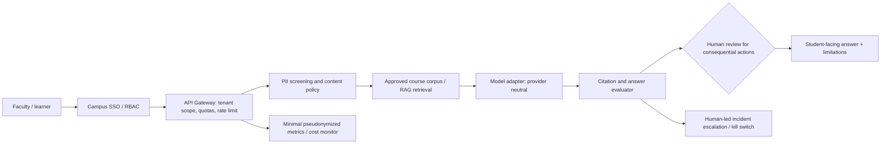

# Applied AI Architect — university pilot reference architecture

**Independent research design; not an OpenAI, university, or government deployment.** Target role: [Applied AI Architect, Education](https://openai.com/careers/applied-ai-architect-education-london-uk/).

## User problem and scope

Faculty and approved university staff need a controlled AI assistant for **public course information** and **synthetic assessment exercises**, with explicit human review. Student personal data, medical or special-category data, identifiable grades, research participant records, employee evaluations and unpublished manuscripts are **out of scope** until a lawful basis, institutional approval and documented privacy assessment are in place.

## Design decisions

| Component | Pilot control | Evidence to collect |
|---|---|---|
| Access | University SSO, per-course RBAC, least privilege | authz tests, access denied logs |
| Content | University-approved public teaching corpus, versioned and permissioned | course source list, licensing approvals |
| Model | Replaceable provider adapter, no hard-coded provider/contract | adapter conformance results |
| Retrieval | Store immutable document IDs, citation coverage and corpus version | provenance manifests |
| Privacy | Data minimization, bounded retention and EU hosting review | DPIA, DPA, lawful basis, retention schedule |
| Accessibility | screen reader and language testing, WCAG-oriented acceptance criteria | documented user tests |
| Academic quality | faculty-curated blind test set, abstention, unsupported-citation checks | labeled holdout, reviewer signoff |
| Security | secret store, rate limit, no raw-prompt telemetry by default, incident procedure | pen-test report, incident drill |
| Operations | budget caps, concurrency/load test, fail-closed guardrails and model rollback | load test, rollback evidence |
| Governance | student AI-use notice, human appeal and material decisions reserved to faculty | policy signoff, appeal cases |

## Data protection and risk boundaries

- No live ingestion of university data is implemented by this repository.
- GDPR compliance and cross-border data transfers require actual institutional counsel review, applicable contractual terms and lawful-basis verification.
- A model-provider API call must not occur without the institution's approved data-classification decision and contractual controls.
- Avoid equating cached/generated text with verified financial or academic facts.
- Maintain a reproducible retrieval set, evaluator protocol and incident response runbook.

## Pilot schedule / decision gates

1. **Requirements:** engage faculty, IT, privacy office, accessibility leads and students; capture current service-level and cost baseline.
2. **Sandbox:** public training documents only, synthetic prompts, deterministic unit tests and safety rejection tests.
3. **Shadow evaluation:** two model configurations, licensed benchmark data, documented hallucination/citation error categories, cost and latency comparisons.
4. **Limited pilot:** small opt-in cohort with human support, rollback control, usage budget and incident review.
5. **Decision:** independent evaluation and institutional sponsor approve or reject expansion; no automated production approval.

## Acceptance metrics (proposed, not observed)

- **Support quality:** response accuracy versus independently annotated gold, citation support precision, abstention rate, user appeals.
- **Operational:** P50/P95 latency, availability, rollback time, cost per resolved request, staff labor hours, accessibility defects.
- **Governance:** percentage of data-flow records with approval, number of unreviewed consequential decisions (target zero), policy exceptions.

## Cost and return-on-investment

See [cost_model.py](cost_model.py). The model computes a **scenario**, not actual savings or causal ROI. Any ROI must compare a controlled pilot with documented baseline, staffing, training and opportunity costs.
